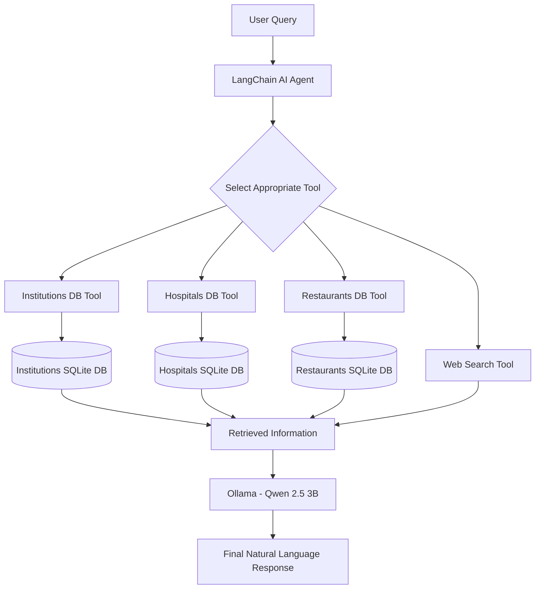

# Bangladesh Multi-Tool AI Agent 🇧🇩

An AI-powered question-answering agent that combines structured Bangladesh-specific datasets with general web search capabilities. Built using **LangChain, Ollama, SQLite, Hugging Face Datasets, and DuckDuckGo Search**.

The agent intelligently selects the appropriate tool to answer questions about educational institutions, healthcare organizations, restaurants, and general knowledge.

## 🚀 Project Overview

Finding reliable information about Bangladeshi institutions, healthcare organizations, and restaurants can be challenging when information is scattered across different sources.

This project addresses that problem by integrating multiple structured datasets into SQLite databases and providing an AI agent that can query these databases or search the web depending on the user's question.

The system uses a single LangChain agent equipped with four specialized tools.

## ✨ Key Features

- **Intelligent Tool Selection:** Automatically selects the appropriate tool based on the user's question.
- **Educational Institution Search:** Retrieves information about schools, colleges, madrasahs, and other educational institutions in Bangladesh.
- **Healthcare Organization Search:** Retrieves information about healthcare organizations across Bangladesh.
- **Restaurant Search:** Finds restaurants using names, locations, ratings, reviews, and addresses.
- **General Web Search:** Uses DuckDuckGo to answer questions outside the scope of the local datasets.
- **Local LLM Integration:** Uses Ollama with the Qwen 2.5 3B model, avoiding dependence on paid LLM APIs.
- **SQLite Databases:** Stores and retrieves structured information efficiently.

## 🏗️ System Architecture

The project follows a tool-based AI agent architecture.



### How It Works

1. The user submits a question through the command-line interface.
2. The LangChain agent analyzes the question.
3. The agent selects the most relevant tool.
4. For Bangladesh-specific queries, the corresponding tool executes a read-only SQL query against its SQLite database.
5. For general knowledge queries, the agent invokes the DuckDuckGo web search tool.
6. The retrieved information is processed by the local Qwen 2.5 3B model.
7. The agent generates a natural-language response for the user.

## 🗂️ Datasets

The project uses three datasets hosted on Hugging Face.

| Dataset | Records | Purpose |
|---|---:|---|
| Institutional Information of Bangladesh | 34,901 | Educational institution information |
| All Bangladeshi Hospitals | 38,886 | Healthcare organization information |
| Bangladeshi Restaurant Data | 12,703 | Restaurant information, ratings, and addresses |

**Total records: 86,490**

### Dataset Sources

- [Institutional Information of Bangladesh](https://huggingface.co/datasets/Mahadih534/Institutional-Information-of-Bangladesh)
- [All Bangladeshi Hospitals](https://huggingface.co/datasets/Mahadih534/all-bangladeshi-hospitals)
- [Bangladeshi Restaurant Data](https://huggingface.co/datasets/Mahadih534/Bangladeshi-Restaurant-Data)

### Database Structure

The datasets are converted into three SQLite databases:

| Database | Table |
|---|---|
| `institutions.db` | `institutions` |
| `hospitals.db` | `hospitals` |
| `restaurants.db` | `restaurants` |

The database tools execute read-only SQL queries to retrieve relevant records.

## 🛠️ Technologies Used

| Technology | Purpose |
|---|---|
| Python | Core programming language |
| LangChain | AI agent and tool orchestration |
| Ollama | Local LLM execution |
| Qwen 2.5 3B | Language model |
| SQLite | Structured database storage |
| Hugging Face Datasets | Dataset loading |
| Pandas | Data processing |
| DuckDuckGo Search | General web search |
| LangChain Community | Web search integration |

## 📁 Project Structure

```text
multi_tool_ai_agent_for_bangladesh/
│
├── agent.py
├── data_loader.py
├── requirements.txt
├── README.md
├── .gitignore
│
├── databases/
│   ├── institutions.db
│   ├── hospitals.db
│   └── restaurants.db
│
└── tools/
    ├── __init__.py
    ├── database_tools.py
    └── web_search_tool.py
```

## ⚙️ Installation and Setup

Follow these steps to run the project locally.

### 1. Clone the Repository

```bash
git clone https://github.com/YOUR_USERNAME/multi_tool_ai_agent_for_bangladesh.git

cd multi_tool_ai_agent_for_bangladesh
```

Replace `YOUR_USERNAME` with your GitHub username.

### 2. Create a Virtual Environment

```bash
python -m venv .venv
```

Activate it on Windows:

```powershell
.venv\Scripts\Activate
```

### 3. Install Dependencies

```bash
pip install -r requirements.txt
```

### 4. Install and Configure Ollama

Download Ollama from:

https://ollama.com/

Pull the required model:

```bash
ollama pull qwen2.5:3b
```

Make sure Ollama is running before starting the application.

### 5. Create the Databases

Run the data loader:

```bash
python data_loader.py
```

This downloads the Hugging Face datasets and creates the three SQLite databases inside the `databases/` directory.

### 6. Run the AI Agent

```bash
python agent.py
```

The command-line interface will start, allowing you to ask questions.

Type `exit` to terminate the application.

## 💬 Example Queries

### Educational Institution Queries

```text
Find five schools in Dhaka.

Show me educational institutions in Chittagong.

Find institutions in a specific district.
```

### Healthcare Organization Queries

```text
Show me five healthcare organizations in Dhaka.

Find healthcare organizations in a specific district.
```

### Restaurant Queries

```text
Find five restaurants with ratings above 4.5.

Show restaurants located in Dhaka.

Find restaurants with the highest ratings.
```

### General Knowledge Queries

```text
Explain the difference between machine learning and deep learning.

What is artificial intelligence?

Explain how neural networks work.
```

The agent determines whether to use a Bangladesh-specific database tool or the web search tool based on the question.

## ⚠️ Dataset Limitations

The system's responses depend on the information available in the source datasets.

- The institutional dataset contains educational institution information, but its coverage and accuracy depend on the original source.
- The healthcare dataset includes broader healthcare organizations, such as public health institutions and administrative offices, not exclusively hospitals.
- The restaurant dataset does not contain a dedicated city or district column. Location-based searches therefore rely on the address field.
- Information such as hospital bed capacity, doctor availability, and medical facilities cannot be retrieved because these fields are not available in the dataset.
- Web search results depend on the availability and relevance of information indexed by DuckDuckGo.

The system does not guarantee that all retrieved information is complete or up to date.

## 🔒 Security and Query Handling

The database tools are designed to execute read-only SQL queries.

- Only `SELECT` queries are permitted.
- Multiple SQL statements are rejected.
- Database connections use read-only mode.
- Query results are limited to 20 records per execution.

## 🎯 Project Objective

This project demonstrates how a tool-based AI agent can combine structured databases and external web search to answer domain-specific and general knowledge questions.

It showcases practical applications of:

- LLM-powered agent orchestration
- Tool calling and intelligent routing
- SQL database integration
- Local language model deployment
- External search integration
- Natural-language question answering

---

**Developed as part of an AI Engineering course project.**